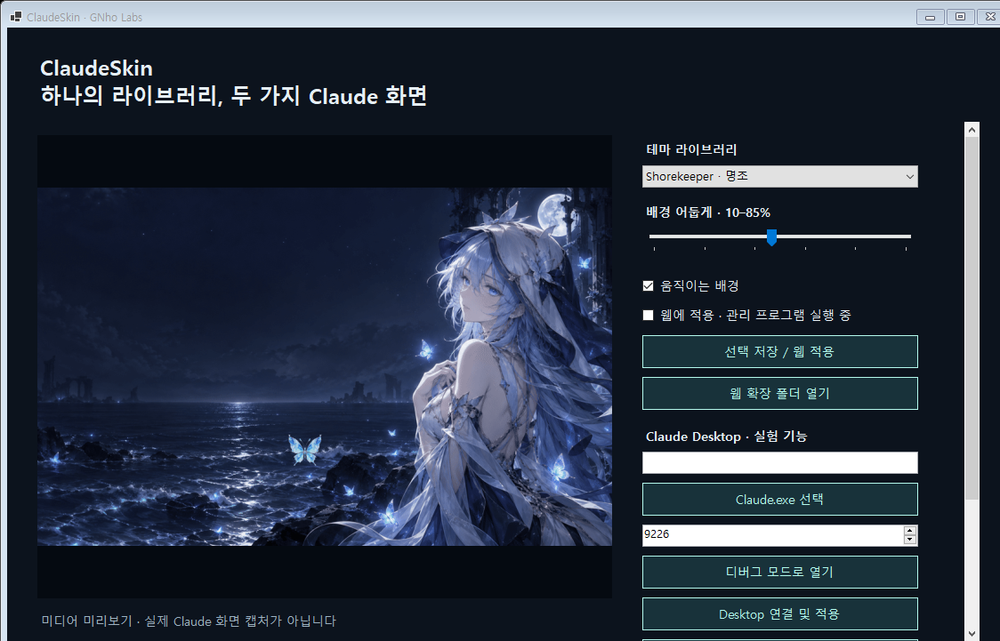

# ClaudeSkin

**하나의 Windows 프로그램에서 Claude 웹과 Desktop의 움직이는 테마를 관리합니다.**

현재 **0.1.0 미리보기**입니다. 웹 확장과 Desktop 연결 코드를 구현했고, 실제 Claude 화면 호환성 검증은 진행 중입니다. Anthropic 공식 제품이 아닙니다.

[English](README.md) · [검증 상태](docs/VALIDATION.md) · [미디어 출처](docs/ASSET-NOTES.md) · [GNho Labs](https://gnholabs.com) · [Live preview](https://gnholabs.com/claudeskin/)



## 포함된 테마

| 테마 | 미디어 | 움직임 끄기 / 시스템 동작 감소 |
| --- | --- | --- |
| Shorekeeper · 명조 | GIF | PNG 포스터 |
| Firefly · 붕괴: 스타레일 | MP4 | PNG 포스터 |
| Jinhsi · 명조 | MP4 | PNG 포스터 |

기존 CoSkin 라이브러리에서 가져온 테마입니다. 공식 게임 아트라는 뜻은 아니며, 코드와 미디어의 라이선스는 다릅니다.

## Windows에서 사용

[Releases](https://github.com/GNh0/ClaudeSkin/releases)의 `ClaudeSkin-0.1.0-win-x64.zip`을 새 폴더에 풀고 `ClaudeSkin.exe`를 실행합니다. 폴더 안의 `themes`, `shared`, `extension`도 같이 있어야 합니다. 관리 프로그램은 관리자 권한이나 Claude API 키가 필요하지 않습니다. 선택한 테마 설정은 `%LOCALAPPDATA%\ClaudeSkin\settings.json`에 저장합니다.

### Claude 웹

1. Chrome의 `chrome://extensions` 또는 Edge의 `edge://extensions`에서 개발자 모드를 켭니다.
2. **압축해제된 확장 프로그램 로드**에서 배포 폴더의 `extension`을 선택합니다. Chrome Web Store에 배포된 확장은 아직 없습니다.
3. ClaudeSkin에서 테마와 어둡기를 선택하고 **웹에 적용**을 체크한 뒤 **선택 저장 / 웹 적용**을 누릅니다.
4. `https://claude.ai`를 새로고침합니다. 변경은 약 5초 후 반영됩니다. 관리 프로그램을 닫으면 확장은 연결 종료를 확인한 뒤 테마를 제거합니다.

웹 확장은 Claude 페이지와 로컬 `127.0.0.1` 관리 서비스에만 접근합니다. 대화 본문을 읽어 전송하는 기능, 계정 로그인, API 호출은 없습니다. Claude 화면의 구조나 보안 정책이 바뀌면 배경이 표시되지 않을 수 있습니다.

### Claude Desktop — 실험 기능

1. Claude Desktop을 평소 방식으로 설치합니다. 이미 실행 중이라면 직접 정상 종료합니다.
2. ClaudeSkin에서 **Claude.exe 선택**으로 공식 실행 파일을 선택합니다. Microsoft Store 버전은 `WindowsApps`의 접근 권한에 따라 선택하기 어려울 수 있습니다.
3. 비어 있는 포트를 선택하고 **디버그 모드로 열기**를 누릅니다.
4. Claude의 채팅 화면이 로딩되면 **Desktop 연결 및 적용**을 누릅니다.
5. **기본 화면 복원**으로 주입된 테마를 제거합니다. 사용 후 Claude Desktop을 정상 종료하고 평소 방식으로 다시 실행해 디버그 포트를 닫습니다.

Desktop 연결은 `127.0.0.1`에서 선택한 Claude 실행 파일이 소유한 포트와 `https://claude.ai` 화면만 허용합니다. 앱 설치 파일을 수정하거나 기존 프로세스를 강제 종료하지 않습니다. 디버그 모드를 지원하지 않거나 다른 주소의 화면을 사용하는 버전에는 연결되지 않습니다. 디버그 포트는 이 PC의 다른 프로그램에서도 접근할 수 있습니다. **실제 Desktop 적용과 캡처는 아직 검증하지 못했습니다.**

## 개발

```powershell
dotnet build -c Release
.\bin\Release\net9.0-windows\ClaudeSkin.exe --self-test
npm ci
npm test
npm run demo:prepare
```

`dotnet publish -c Release -r win-x64 --self-contained true -p:PublishSingleFile=true -p:IncludeNativeLibrariesForSelfExtract=true -o artifacts/win-x64`로 Windows x64 배포 폴더를 만듭니다. 변경한 공통 엔진은 `extension/skin-engine.js`에도 복사해야 하며 테스트가 일치 여부를 확인합니다.

웹용과 Desktop용 어댑터는 같은 `shared/skin-engine.js`, `shared/skin.css`, `themes/catalog.json`을 사용합니다. 데모 페이지는 이 엔진을 샘플 대화 UI에 실제로 적용하며 공식 Claude 캡처로 표시하지 않습니다.
